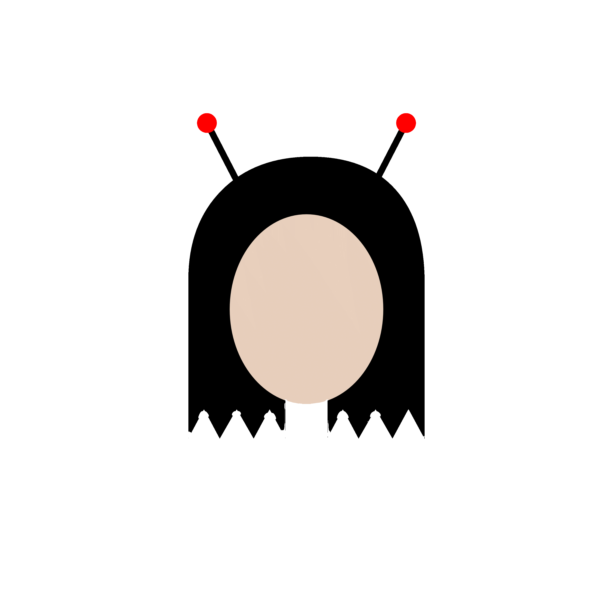
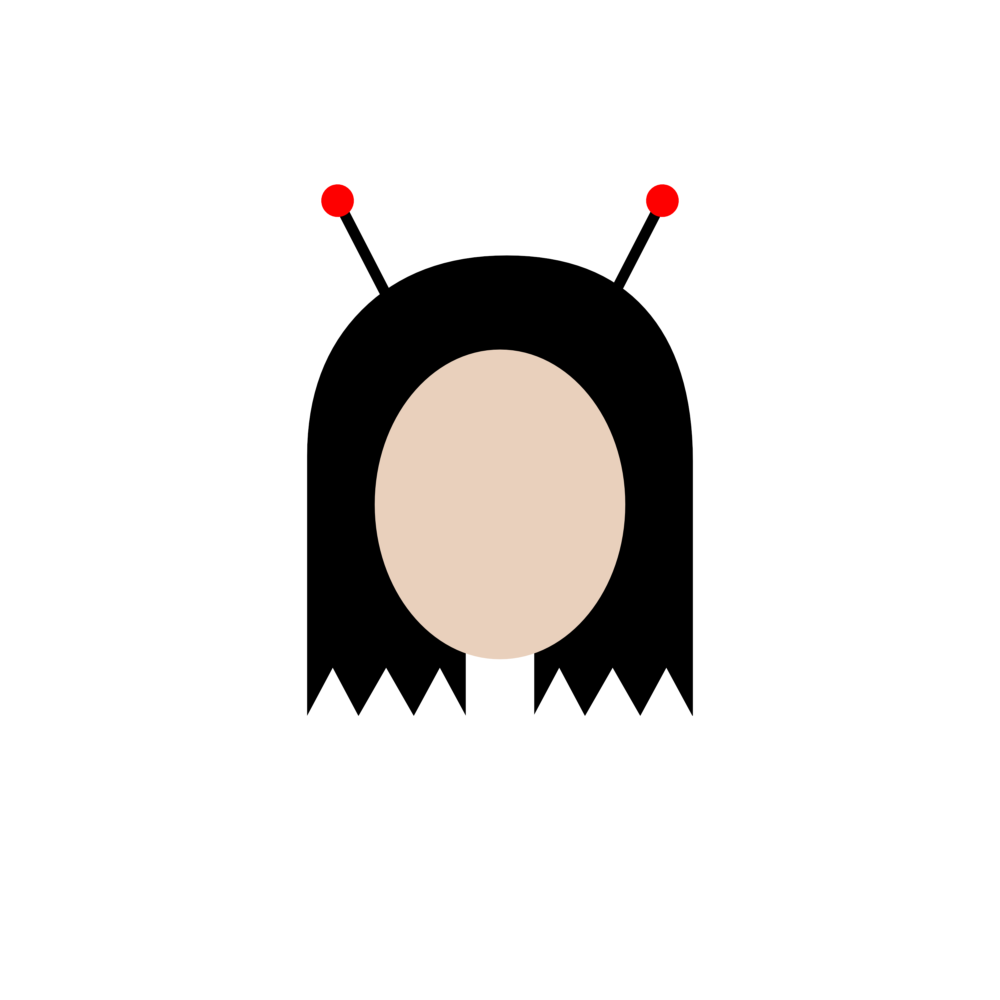
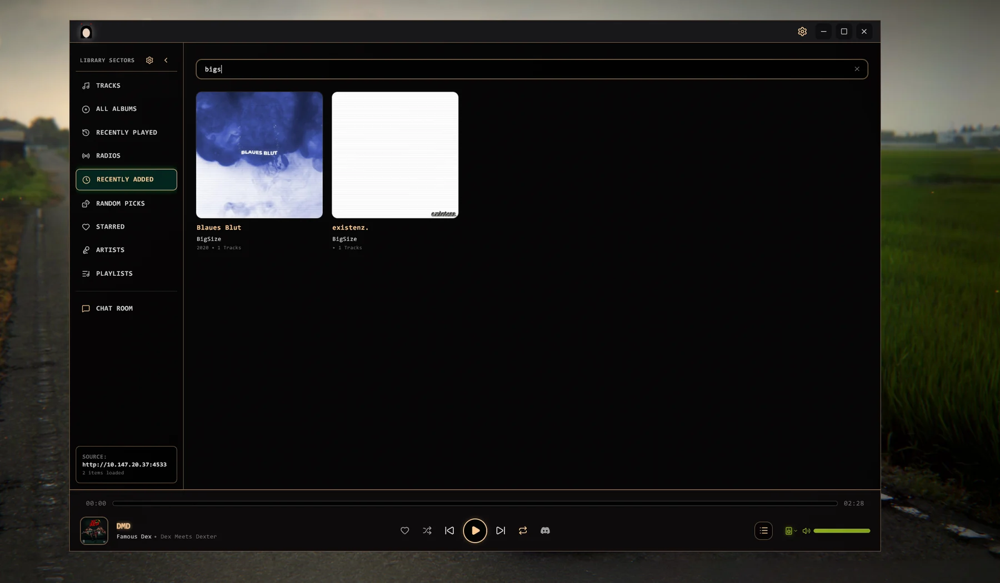
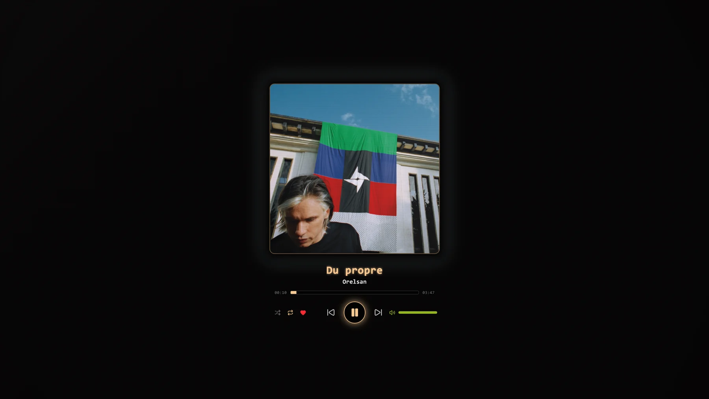
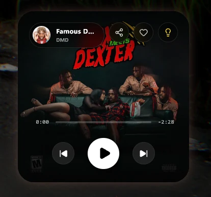
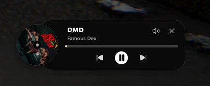

<p align="center">
  
</p>

<h1 align="center">NOISE</h1>
<h3 align="center">Retro CRT Music Player for Navidrome &amp; Subsonic</h3>

<p align="center">
  
  
  
  
</p>

---

Welcome to **NOISE**. This isn't just another music player — it's a love letter to the era
of glowing phosphors and chunky scanlines, built for the modern streaming age.

If you run a **Navidrome** or **Subsonic** server, you already know how great it is to truly
own your music. With NOISE you experience that entire library through an interface that feels
like it was ripped straight out of a nineties cyberpunk hacker den.

<p align="center">
  
</p>

---

## ✨ Highlights

| | Feature |
|---|---|
| 🖥️ | **Authentic CRT aesthetic** — phosphor glow, scanlines, curvature, flicker & glass glare |
| 🎛️ | **8 phosphor themes** — classic green, amber, ice white, cyberpunk, synthwave, blood quartz, arcade '84, custom |
| 🎨 | **Font presets** — Classic, Terminal (Share Tech Mono) and Modern (Be Vietnam Pro) |
| 🎧 | **Real crossfade** — equal-power blending from 1–12 seconds (off by default) |
| ⚡ | **Gapless playback** & smart next-track preloading |
| 🎚️ | **5-band parametric EQ** + live audio visualizer (oscilloscope, spectrum, radar, starfield, ASCII) |
| 🖼️ | **Fullscreen Stage** — huge album art with reactive aura and CRT channel-change static |
| 👥 | **Cyber Lounge** — create rooms, chat with friends and share what you're listening to in real time |
| 🤖 | **Discodrome bridge** — Discord Rich Presence & remote control |
| 🔁 | **Portable & open source** — Windows, macOS and Linux builds, no account required |

---

## 🆕 What's new in 2.0

- **Three-stage HDR Phosphor Boost** — `OFF` / `SOFT` / `STRONG`, with a gentler `SOFT` mode tuned for OLED/HDR displays.
- **Queue drag & drop** — reorder the playback queue with the same handle-based drag system as playlists.
- **Real scrobbles** — completed plays are submitted to Navidrome/Last.fm after 50% or 4 minutes.
- **Refined glows** — multi-layer soft shadows reduce banding and remove clipped glow edges across the player and widget.
- **Playlist search** — the playlist header search opens as a connected pill with live filtering.
- **Discord Control polish** — official Discord blurple, matching LIVE/BOT badges and softer player glows.

---

## 🎧 Playback & Crossfade

NOISE uses **two audio decks** for seamless transitions:

- **Crossfade** blends the end of one song into the next with an equal-power curve.
  Duration is adjustable (1–12 s) and **disabled by default**.
- **Gapless switching** when crossfade is off — the next buffered track starts instantly.
- **Preloading:** the next queue track is loaded in advance (last 45 s / 35 % of the song),
  so you never hear a gap.
- **Radio streams** and **repeat-one** are intentionally left untouched.

---

## 🎨 Design System

- **8 phosphor themes**, each emulating a real vintage display.
- **3 font presets** — switch instantly under *Settings → Display*.
- **Library card styles** — *Minimal* (cover + text) or *Boxed* (framed card).
- **Collapsible action bar** — all player actions behind one "more" button that slides open.
- **Frosted UI pills**, accent glows and subtle CRT motion everywhere.

---

## 📸 Screenshots

### 🎵 Library View
<p align="center">
  
</p>

### 🖥️ Fullscreen Stage
<p align="center">
  
</p>

### 🪟 Widget & Mini Player
<table align="center">
  <tr>
    <td align="center"></td>
    <td align="center"></td>
  </tr>
  <tr>
    <td align="center"><b>Widget Player</b></td>
    <td align="center"><b>Mini Player</b></td>
  </tr>
</table>

---

## 📦 Download

Head over to the **[Releases](../../releases)** tab and grab the build for your system:

| Platform | File |
|---|---|
| 🪟 **Windows** | `Noise-2.0.0-win.zip` (or the `.exe` installer) |
| 🍎 **macOS (Apple Silicon)** | `Noise-2.0.0-macOS-AppleSilicon-arm64.dmg` |
| 🍎 **macOS (Intel)** | `Noise-2.0.0-macOS-Intel-x64.dmg` |
| 🐧 **Linux** | `noise-2.0.0.tar.gz` |

SHA-256 checksums for all 2.0.0 builds are included in `SHA256SUMS-2.0.0.txt`.

---

## 🚀 Installation

### Windows
Extract `Noise-2.0.0-win.zip` and run **`Noise.exe`**. No installation required.

### macOS
1. Open the DMG and drag **Noise.app** into **Applications**.
2. Because the app is unsigned (not from the Mac App Store), Gatekeeper may block the
   first launch. Open **Terminal** and run:

```bash
sudo xattr -rd com.apple.quarantine /Applications/Noise.app
```

3. Enter your Mac password (it stays hidden) and launch NOISE normally.

> Fullscreen on macOS uses *simple fullscreen*, so the window stays on your current
> desktop — no separate Space, and you can keep working.

### Linux
```bash
tar -xzf noise-2.0.0.tar.gz
cd noise-2.0.0
./noise          # or ./start-noise.sh
```

---

## 🛠️ Build from source

```bash
git clone https://github.com/pipio2314-cell/Noise-CRT-Player.git
cd Noise-CRT-Player
npm install
npm run build
```

**Desktop builds:**

```bash
# Windows (ZIP + installer)
npm run electron:build

# Linux (tar.gz with icon + launcher)
npm run build && electron-builder --linux dir
python scripts/pack-linux.py --tar-only

# macOS (DMG — Apple Silicon / Intel)
python scripts/create-mac-dmg.py --arch=arm64
python scripts/create-mac-dmg.py --arch=x64
```

---

## 🧱 Tech Stack

- **Frontend:** React 19 + TypeScript + Vite + Tailwind CSS v4
- **Desktop:** Electron 43 (frameless transparent window, custom CRT chrome)
- **Audio:** Web Audio API (5-band EQ, analyser, dual-deck crossfade)
- **Backend protocol:** Subsonic REST v1.16.1 (Navidrome compatible)
- **Realtime Lounge:** Firebase Realtime Database
- **Integrations:** Discodrome Discord bot bridge

---

## 🎨 Customizing

Everything visual lives in **Settings**:

- **Display** — themes, color palette, CRT effects, fonts, card style
- **Playback** — crossfade on/off + duration
- **Miniplayer** — transparency and auto-hide
- **Equalizer** — presets and 5-band tuning

---

## 🤝 Contributing

Issues and pull requests are welcome. If you build something cool with NOISE,
I'd love to see it.

---

## 💛 A note from the developer

I built this project because I wanted a music player that actually had some soul.
I hope you enjoy using it just as much as I enjoyed bringing it to life.

> *Built for people who still believe a progress bar can glow.*
