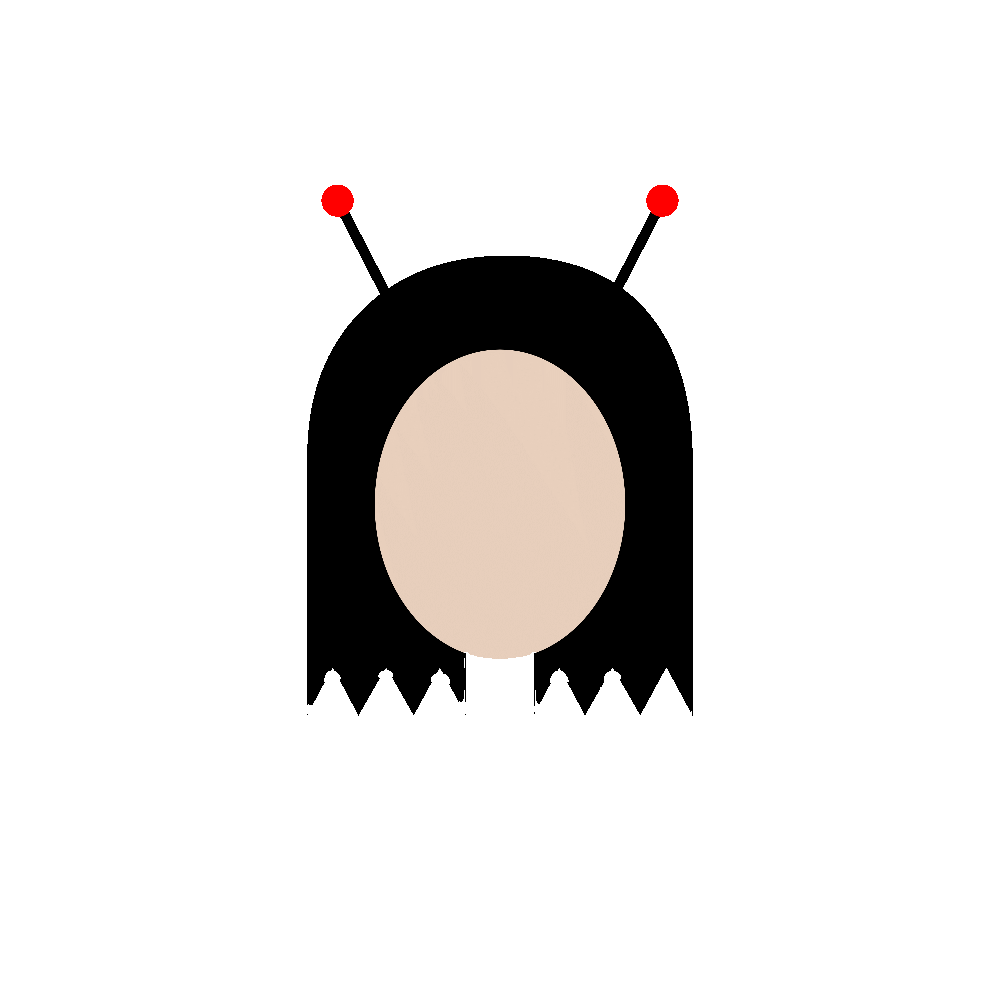
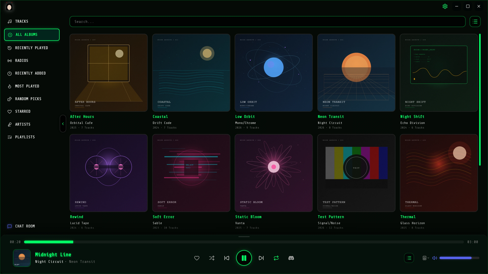
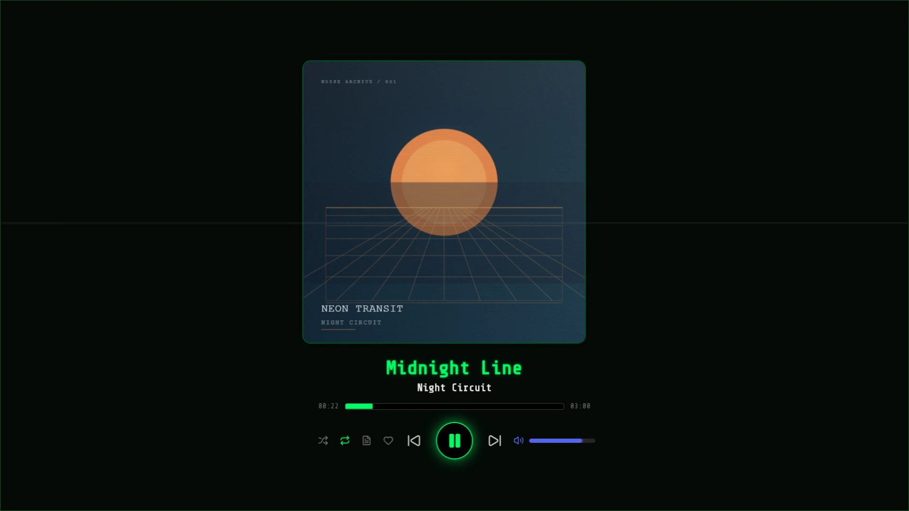
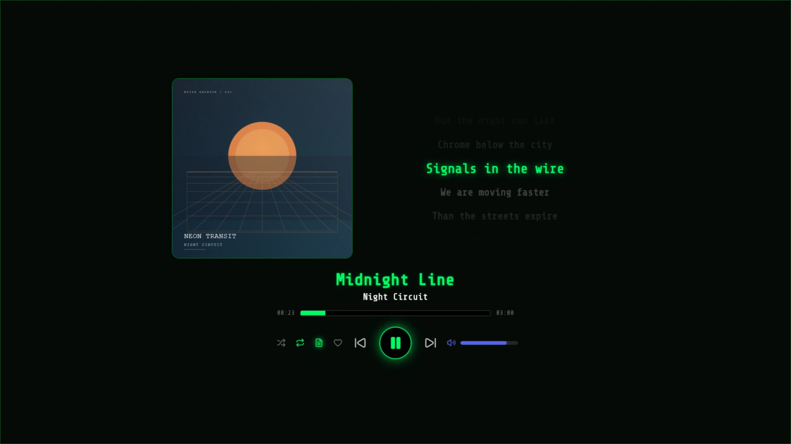
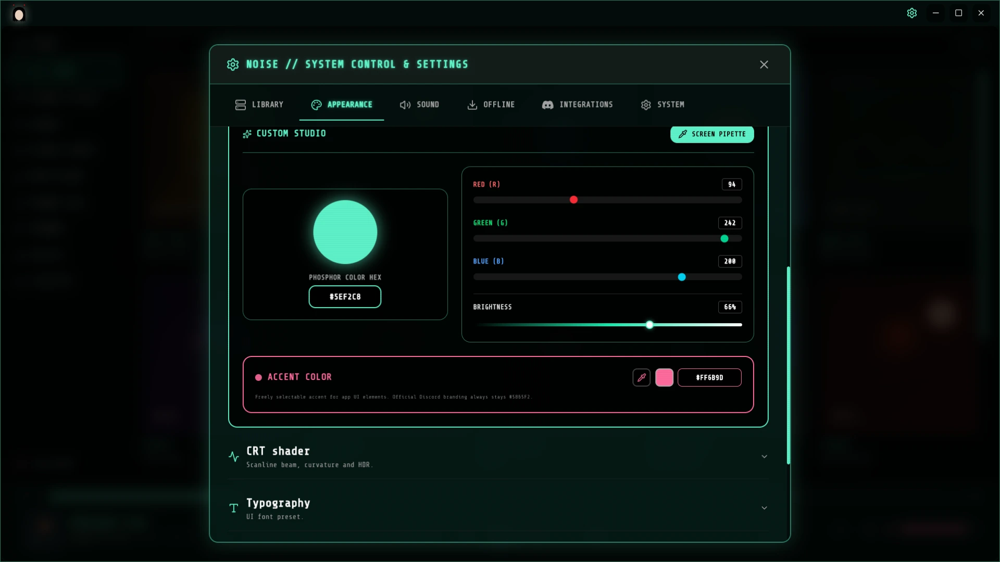
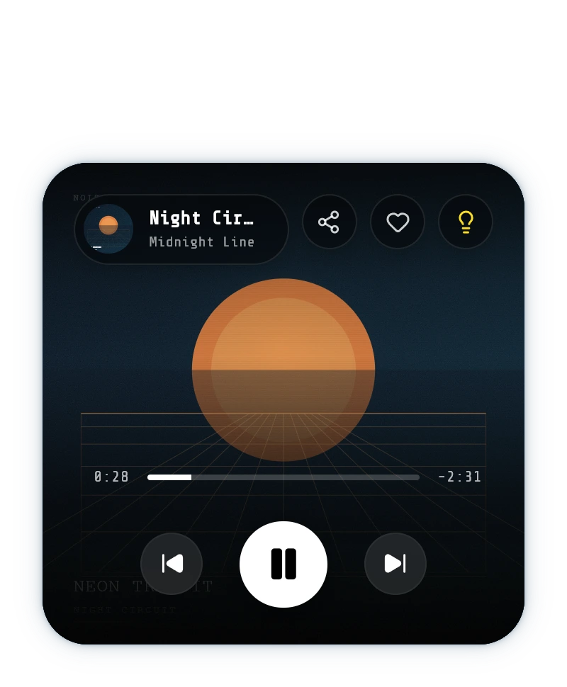
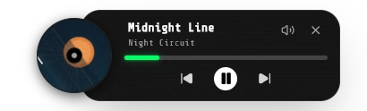

<p align="center">
  
</p>

<h1 align="center">NOISE</h1>
<h3 align="center">Retro CRT Music Player for Navidrome &amp; Subsonic</h3>

<p align="center">
  
  
  
  
</p>

---

Welcome to **NOISE**. This isn't just another music player — it's a love letter to the era
of glowing phosphors and chunky scanlines, built for the modern streaming age.

If you run a **Navidrome** or **Subsonic** server, you already know how great it is to truly
own your music. With NOISE you experience that entire library through an interface that feels
like it was ripped straight out of a nineties cyberpunk hacker den.

<p align="center">
  
  <br />
  <sub>Demo library: every album, artist and track shown here is fictional.</sub>
</p>

---

## Highlights

| Feature | What it does |
|---|---|
| **Authentic CRT aesthetic** | Phosphor glow, scanlines, curvature and flicker in a native desktop shell. |
| **8 phosphor themes** | Classic green, amber, ice white, cyberpunk, synthwave, blood quartz, arcade '84 and a full custom palette. |
| **Custom colour studio** | Pick a phosphor colour with the hex field, RGB sliders, brightness control or the screen pipette, then choose a separate accent. |
| **3 font presets** | Classic, Terminal (Share Tech Mono) and Modern (Be Vietnam Pro). |
| **Real crossfade** | Equal-power blending from 1–12 seconds, disabled by default. |
| **Gapless playback** | Smart next-track preloading so album runs never break. |
| **5-band parametric EQ** | Live visualizers: oscilloscope, spectrum, radar, starfield and ASCII. |
| **Fullscreen Stage** | Huge album art, a reactive aura, CRT channel-change static and synchronized live lyrics. |
| **Cyber Lounge** | Create rooms, chat with friends and share what you're listening to in real time. |
| **Discodrome bridge** | Discord Rich Presence and remote playback through the [Discodrome bot](https://github.com/7eventy7/discodrome). |
| **Freeware & portable** | Windows, macOS and Linux builds. No account required. |

---

## What's new in 2.2.6

2.2.6 is a focused polish release on top of 2.2.5: deleted server items no longer leave dead folders behind, the screen pipette works across the desktop with a visible overlay, and both phosphor and accent colours get a real hex picker.

- **Deleted items disappear** — if the server says an album, artist or playlist no longer exists, NOISE removes only that item from its caches and the visible library. No empty folders, no global cache reset; offline caches stay intact.
- **Screen pipette, everywhere** — a full-screen picker with CRT HUD, magnifier, pixel crosshair and live hex now works over the desktop and other applications. Esc cancels; native EyeDropper remains the fallback.
- **Full hex colour picker** — saturation/value field, hue slider, exact 3/6-digit hex input, RGB readout and presets for both **Phosphor Color** and **Accent Color**.
- **Everything from 2.2.5** — infinite library scrolling, instant artist pages, no-flash drilldowns, Windows snap, CRT window-control animations and the stage/mini/widget maximized-state fixes.

---

## Playback & Crossfade

NOISE uses **two audio decks** for seamless transitions:

- **Crossfade** blends the end of one song into the next with an equal-power curve.
  Duration is adjustable (1–12 s) and **disabled by default**.
- **Gapless switching** when crossfade is off — the next buffered track starts instantly.
- **Preloading:** the next queue track is loaded in advance (last 45 s / 35 % of the song),
  so you never hear a gap.
- **Radio streams** and **repeat-one** are intentionally left untouched.

---

## Discord integration

NOISE talks to **[Discodrome](https://github.com/7eventy7/discodrome)**, a self-hosted Discord music bot for Subsonic-compatible servers. Open **Settings → Integrations**, point NOISE at the bot's local HTTP API, and send the current track, album, playlist or a random pick straight to your Discord voice channel. Discord playback can also drive NOISE, so both players stay in sync. The companion browser extension is included in `discodrome extension/`.

---

## Design System

- **8 phosphor themes**, each emulating a real vintage display.
- **3 font presets** — switch instantly under *Settings → Display*.
- **Library card styles** — *Minimal* (cover + text) or *Boxed* (framed card).
- **Collapsible action bar** — all player actions behind one "more" button that slides open.
- **Frosted UI pills**, accent glows and subtle CRT motion everywhere.

---

## Screenshots

The library view above uses a fictional demo collection, so no personal library data or server addresses are shown.

### Fullscreen Stage

<p align="center">
  
</p>

### Stage with Live Lyrics

<p align="center">
  
</p>

### Custom Colors in Settings

<p align="center">
  
</p>

### Widget & Mini Player

<table align="center">
  <tr>
    <td align="center"></td>
    <td align="center"></td>
  </tr>
  <tr>
    <td align="center"><b>Widget Player</b></td>
    <td align="center"><b>Mini Player</b></td>
  </tr>
</table>

---

## Download

Head over to the **[Releases](../../releases)** tab and grab the build for your system:

| Platform | File |
|---|---|
| **Windows** | `Noise-2.2.6-win.zip` (or the `.exe` installer) |
| **macOS (Apple Silicon)** | `Noise-2.2.6-macOS-AppleSilicon-arm64.dmg` |
| **macOS (Intel)** | `Noise-2.2.6-macOS-Intel-x64.dmg` |
| **Linux** | `noise-2.2.6.tar.gz` |

SHA-256 checksums for all 2.2.6 builds are included in `SHA256SUMS-2.2.6.txt`.

> **Upgrading from 2.0.0:** the GitHub account was renamed from `pipio2314-cell` to `020KIKI`. Please download 2.2.6 manually once; after that, future updates work automatically.
>
> **Upgrading from 2.2.1:** the old updater needs one manual update. Download 2.2.6 once; after that, Windows self-updates work.
>
> **Upgrading from 2.2.2:** Windows uses the in-app ZIP self-update, macOS keeps the DMG workflow and Linux updates the tar.gz in place.
>
> **Upgrading from 2.2.0 (installed):** 2.2.0 uses the installer once for this update. After that, Windows updates are in-app via ZIP.
>
> **Upgrading from 2.2.0 (portable ZIP):** extract `Noise-2.2.6-win.zip` over the old folder once, then start `Noise.exe`. Future updates are in-app.

NOISE is freeware for personal, non-commercial use. See [LICENSE](LICENSE) for the full terms.

---

## Installation

### Windows

Extract `Noise-2.2.6-win.zip` and run **`Noise.exe`**. No installation required.

### macOS

1. Open the DMG and drag **Noise.app** into **Applications**.
2. Because the app is unsigned (not from the Mac App Store), Gatekeeper may block the
   first launch. Open **Terminal** and run:

```bash
sudo xattr -rd com.apple.quarantine /Applications/Noise.app
```

3. Enter your Mac password (it stays hidden) and launch NOISE normally.

> Fullscreen on macOS uses *simple fullscreen*, so the window stays on your current
> desktop — no separate Space, and you can keep working.

### Linux

```bash
tar -xzf noise-2.2.6.tar.gz
cd noise-2.2.6
./noise          # or ./start-noise.sh
```

---

## License

NOISE is **freeware**, not open source.

- Free for personal, non-commercial use
- Redistribution, modification, reverse engineering, and commercial use are not permitted
- All rights reserved

See [LICENSE](LICENSE) for the full terms. Third-party components remain under their respective licenses; see [THIRD_PARTY_NOTICES.md](THIRD_PARTY_NOTICES.md).

---

## Tech Stack

- **Frontend:** React 19 + TypeScript + Vite + Tailwind CSS v4
- **Desktop:** Electron 43 (frameless transparent window, custom CRT chrome)
- **Audio:** Web Audio API (5-band EQ, analyser, dual-deck crossfade)
- **Backend protocol:** Subsonic REST v1.16.1 (Navidrome compatible)
- **Realtime Lounge:** Firebase Realtime Database
- **Integrations:** [Discodrome](https://github.com/7eventy7/discodrome) Discord bot bridge and the NOISE browser extension

---

## Customizing

Everything visual lives in **Settings**:

- **Display** — themes, custom phosphor and accent colours, CRT effects, fonts, card style
- **Playback** — crossfade on/off + duration
- **Miniplayer** — transparency and auto-hide
- **Equalizer** — presets and 5-band tuning

---

## Bug Reports

Bug reports are welcome! Please open an issue with:

- the NOISE version
- your operating system and version
- steps to reproduce the problem
- expected vs. actual behavior
- screenshots or logs if available

**Code contributions and pull requests are not accepted.** See [CONTRIBUTING.md](CONTRIBUTING.md) for details.

---

## A note from the developer

I built this project because I wanted a music player that actually had some soul.
I hope you enjoy using it just as much as I enjoyed bringing it to life.

> *Built for people who still believe a progress bar can glow.*
